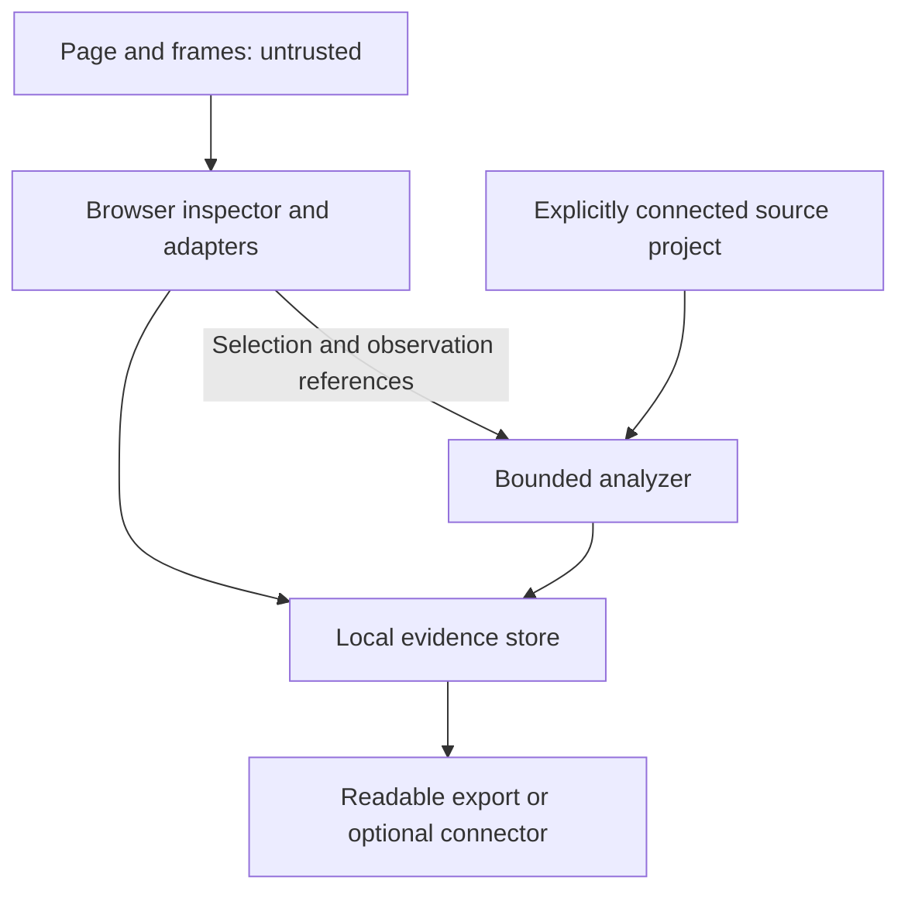

# Architecture

StateAtom is a proposed independent, open-source UI inspection tool by StatePort. This document describes the target architecture, not an inventory of implemented modules or a released API. Implementation evidence and remaining gaps belong in [status](status.md); the rationale for major choices belongs in [decisions](decisions.md).

## Purpose and operating modes

The target workflow starts with a selected UI property and asks what produced it: the exact render expression, relevant transformations, state or cache records, and, where evidence supports the connection, the particular network exchange and JSON field. Every step must distinguish a possible dependency from an observed execution. An incomplete trace is a useful result when its stopping point is explicit.

The independently usable Atom includes the browser inspector, analyzer, supported adapters, optional open IDE and development tooling, local intervention and undo, and evidence export. None of these core capabilities should require a StatePort account, closed resolver, model service, or mandatory cloud API. This is the intended product boundary, not a statement that all paths work today.

Extension-only inspection uses what the browser can observe and what supported runtime adapters expose. An explicitly connected source project can add source locations and deeper static analysis. Optional development instrumentation can record selected execution events. These are distinct capabilities: access to source in an IDE does not establish that an expression executed, and source analysis does not retroactively instrument a running page. Each result records which capabilities supplied it.

## Logical boundaries

These are responsibilities, not proposed repository directories or separately published packages. Keep a single source of truth for evidence records and shared rules; introduce physical boundaries only when implementation needs them.

| Responsibility | Owns | Must not imply |
| --- | --- | --- |
| Browser inspector | Selection, frame context, visible values, inspection UI | A DOM value identifies its producer |
| Runtime adapters | Supported component, state, cache, and execution observations | Unsupported frameworks behave equivalently |
| Analyzer | Bounded source tracing and links to matching observations | A possible code path was executed |
| Experiment controller | Scoped interventions, preconditions, undo, stale-state handling | A temporary effect proves the entire provenance chain |
| Evidence store and export | Claim records, identities, exclusions, invalidation, readable bundles | Export is replay or a complete session recording |

An open IDE connector can supply explicitly authorized project context to the analyzer. A StatePort connector can consume the same evidence interface. Neither owns the analyzer or supplies a hidden dependency required by Atom.

The arrows represent bounded evidence transfer, not permission to execute commands in the receiving environment. See [Security](../SECURITY.md) for trust boundaries and [StatePort integration](stateport-integration.md) for the optional handoff.

## Execution placement

The browser shell owns selection, the local evidence view, and browser permissions. Runtime adapters collect observations in the application context where their supported APIs require it. Code from an inspected page remains untrusted even when it communicates with a bundled adapter.

A source-analysis service can run in the open IDE integration or a local development helper. This is where filesystem access and TypeScript project analysis belong when the browser cannot supply them. The service is distinct from StatePort Desktop and is optional for browser inspection. The location of each capability must be explicit in its configuration and installation instructions.

The browser extension must package its executable logic with its distribution. A separately versioned Atom library is a build-time dependency, not a reason to fetch executable modules from a project server. Chrome documents the relevant [Manifest V3 requirements](https://developer.chrome.com/docs/webstore/program-policies/mv3-requirements), including the limited API-specific exceptions. Any chosen injection method must comply with the applicable browser rules.

Inspection sessions own their subscriptions, retained observations, and installed hooks. Define when collection starts and stops, bound retained data, and release session-owned resources on closure. If relevant events occurred before observation began, report that gap. Closing an inspector must not be described as restoring earlier application state.

## Selection and capability reporting

A selection identifies the property being investigated as well as the element. An adapter may identify the producing component and source binding only where that mapping is supported. The nearest component or a file link alone is not a proven producer of the selected property.

The interface should show the current observation, supported dependencies, their evidence, and any missing information. Offer a source connection for an operation that requires source access; keep other available inspection operations usable. Offer an intervention only when an adapter exposes an eligible target and its cleanup behavior.

A readable summary for QA or a product reviewer uses the same records as the developer view. It can omit low-level detail without changing the meaning of a claim. It does not add a separate inference engine or estimate implementation effort from graph size.

## Analysis approach

Start with a bounded backward trace from the selected property. Resolve the render expression, follow supported symbol and value relationships through transformations, and connect state, cache, and transport boundaries only as far as evidence allows. Prefer adapting existing project analysis before adding a parallel resolver. The default direction is TypeScript-based analysis with ts-morph; its [reference and definition navigation](https://ts-morph.com/navigation/finding-references) supplies useful building blocks, but does not by itself establish runtime data provenance.

Static results may include several feasible producers. Preserve those alternatives instead of selecting the nearest matching value. Unsupported dynamic property access, opaque library behavior, unavailable source maps, generated code, or missing history should produce an explicit boundary. A network entry with the same URL or payload value is not sufficient to attach an exact source claim.

Framework and state adapters should expose narrowly defined observations with their supported versions and limitations. Source instrumentation is an optional development capability for gaps that require execution evidence. A scoped Babel or equivalent build transform is a candidate mechanism; [Babel traversal](https://babeljs.io/docs/babel-traverse) supports visiting and updating syntax-tree nodes. Instrumentation still needs a separate semantic and performance review.

[Joern slicing](https://docs.joern.io/cpg-slicing/) is a possible later analysis option. Introduce it only after a reproducible case demonstrates a concrete gap, a comparison shows useful additional results, and its runtime and operational costs are justified. It is not a default runtime prerequisite. [Peekly](https://github.com/rosoam/peekly) is a candidate starting point for an inspection shell, subject to technical and license review; adopting a shell would not establish the provenance capabilities described here. See [licensing](licensing.md).

Every analysis request needs limits on elapsed time, files, graph expansion, retained data, and output size, with cancellation and visible truncation. The result must identify where and why tracing stopped. Partial work must remain distinguishable from a completed trace, including after cancellation.

## Identity, ordering, and invalidation

Evidence refers to particular events and revisions. Depending on the claim, identity must include the inspection session, navigation, frame, component instance, update, build, and state or data revision. A source span also needs the source revision to which it belongs. These are conceptual requirements, not fixed wire-field names.

Network identity must distinguish repeated exchanges to the same endpoint. Async work must retain enough causal identity to distinguish initiation, completion, and the update that consumed a result. A cache hit needs a cache record and revision, with any known origin linked separately; a later response cannot be substituted for an earlier cache population. Matching values, timestamps, or URLs alone cannot establish these relationships.

Capture that begins after a relevant event must report the missing history. The current value may be observable while its origin remains unknown. An adapter must not manufacture an event identity merely to complete a trace.

Navigation, frame replacement, HMR, unmount, state mutation, and data replacement can invalidate different parts of a result. Invalidate dependent claims at the appropriate scope, retaining historical evidence as historical. An analysis started against one build or state revision must not silently attach its result to another. Interventions and undo must check their preconditions; a stale target requires an explicit stale outcome rather than an unqualified restoration claim. The detailed rules belong in [experiments](experiments.md).

## Evidence and execution discipline

Use the shared evidence types **Observed**, **Code-linked**, and **Experimentally verified** as defined in the [evidence model](evidence-model.md). They apply to individual claims, not a global score or a confidence ladder. A record may combine observation of a displayed value with a code link for a possible producer while leaving the exchange-to-field relationship unknown. An experiment establishes only its stated effect under its recorded conditions.

Probes must observe the application's original execution. They must not rerun a render expression, invoke a getter for inspection, or execute an untaken branch to fill a gap. Transformations must preserve receiver binding, evaluation order, errors, and short-circuit behavior. Source probes cannot promise zero timing overhead; timing-sensitive behavior and observer effects require measurement and disclosure. Adapter reads must also account for getters and proxies instead of treating arbitrary property access as harmless.

The core model should preserve the claim, supporting records, acquisition method, applicable identities, exclusions, and invalidation state. Names used in design discussions are conceptual and proposed until a schema is reviewed and versioned. Export redaction must retain a visible indication of omitted evidence and any resulting limit on a claim.

## Validation and change rules

Validate each supported connection independently: property to expression, expression to transformation, transformation to state or cache revision, and revision to an exact exchange and field. Include competing producers, repeated equal responses, cache reuse, async reordering, late capture, HMR, and stale undo. A successful narrow source-connected workflow does not establish extension-only support or deep tracing across these cases.

Use [validation](validation.md) to define reproducible checks and [status](status.md) to report what has actually been demonstrated. New adapters and analysis engines must preserve the evidence vocabulary, explicit unknown boundaries, cancellation, and standalone operation. Expand infrastructure only when a measured requirement warrants it; the architecture does not call for a mandatory SDK platform, npm package family, or second public extension.

## Imported implementation map

The physical source layout is recorded in [provenance](provenance.md). Current source
analysis is the existing `core/analyzer.mjs` plus `src/engine/slice.mjs`,
using Babel and Vue compilers. The target TypeScript/ts-morph direction above is not
an installed dependency or an implemented replacement. The single browser shell is
`browser-extension/`; open source resolution is `core/bridge.mjs` and `ide-extension/`.
The optional instrumenter, observer and experiment controller stay together in
`src/engine/`. `core/diagnostic.mjs` and the reader are existing basic
diagnostic implementations; the broader evidence model remains target design.

## Embeddable candidate

The existing browser runtime and inspector are extracted as one `@stateport/atom`
package with inert browser entrypoints, explicit platform/client separation and
mount/shutdown lifecycles. Both public standalone and a separate MV3 example
consume it. The official StatePort extension remains a separate future consumer;
Capture/Native Messaging remain outside this package. See [the exact contract](embedding.md)
and [validation](testing/atom-embedding-validation.md). Analyzer/evidence placement
and acceptance criteria are unchanged. This is a local candidate, not a published API.

## Exact connection authority

The [F02 implementation record](completion/15-f02-origin-connections.md) describes
the current connection increment. The browser platform owns canonical exact-origin
session records and scoped debugger leases; the runtime consumes fresh permission,
mode and grant facts. Browser match patterns, application development consent,
artifact-server permission and the helper/source association are separate layers.
Page observations cannot configure any of them. Both platform and runtime must
explicitly opt into read-only HTTPS. Production mutation authorization remains
F05 work; source access never supplies it.

Navigation across origins or lost browser access invalidates the old context,
including pending acquisitions. Unsaved private source/trial material is scoped
to this authority; separately saved historical diagnostics follow their existing
retention and export policy. This does not upgrade any source link or source-map
match to execution/provenance evidence.
